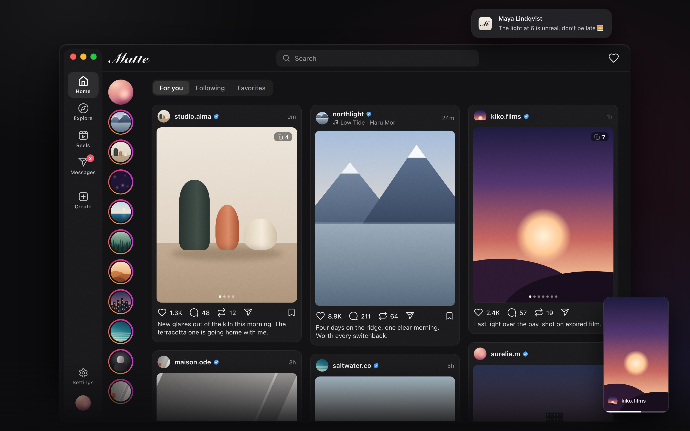
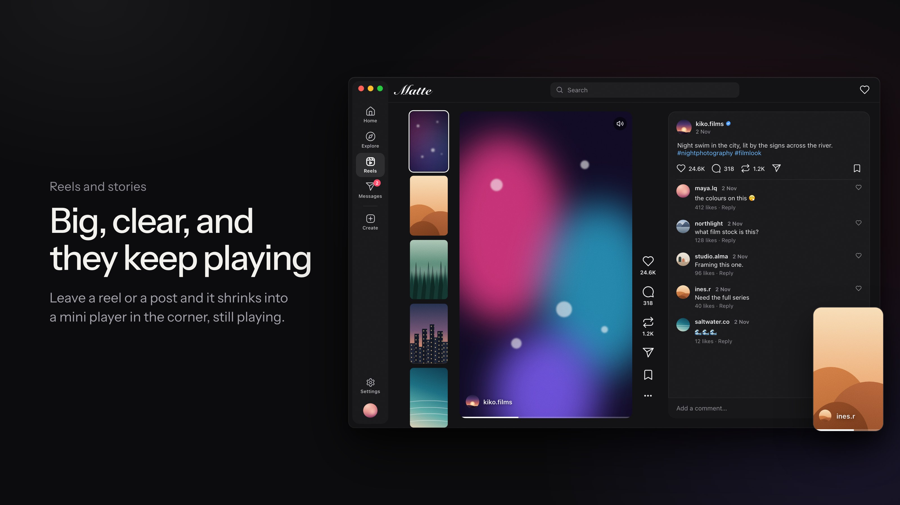
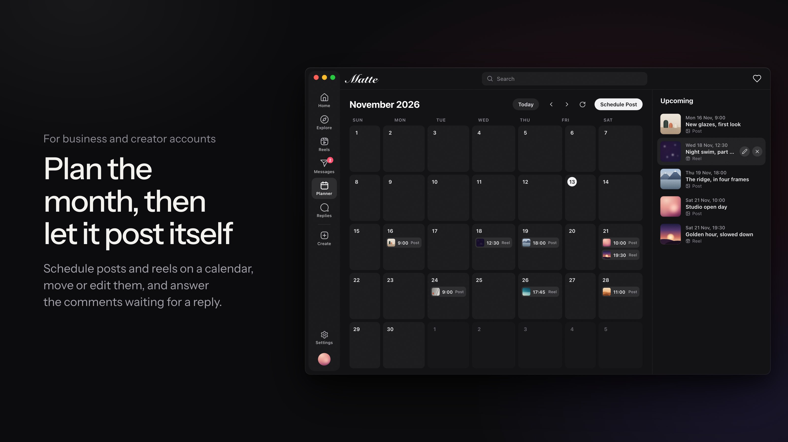
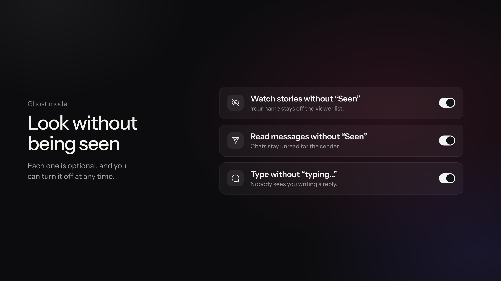

<p align="center">
  
</p>

<h1 align="center">Matte</h1>

<p align="center">
  Your Instagram, on the big screen.<br>
  macOS 15 or later · Apple silicon and Intel · Free and open source (MIT)<br>
  <a href="https://matte.subhashh.tech">matte.subhashh.tech</a>
</p>

<p align="center">
  
</p>

---

Matte is a Mac app for Instagram. It is made for the desktop, not a phone app stretched to fit.

Matte uses your Instagram account. Your feed, messages, Reels, stories and profile are the same as on instagram.com and on your phone.

Matte uses much less memory than instagram.com in a browser, which often takes 4–5 GB.

Matte is not affiliated with Instagram or Meta.

## 1. Install

### 1.1 Install with Homebrew

Run this command in Terminal:

```bash
brew install --cask subhashhhhhh/matte/matte
```

### 1.2 Install from a download

1. Find the type of your Mac. Open the Apple menu › **About This Mac**.
   - If you see **Chip**, your Mac has Apple silicon.
   - If you see **Processor**, your Mac has an Intel processor.
2. Go to the [latest release](https://github.com/subhashhhhhh/Matte/releases/latest).
3. Download the disk image for your Mac:
   - Apple silicon: `Matte-<version>-AppleSilicon.dmg`
   - Intel: `Matte-<version>-Intel.dmg`
4. Open the disk image.
5. Drag **Matte** to **Applications**.

Apple does not notarize Matte, because notarization needs a paid developer account. So macOS stops the app the first time you open a downloaded copy. To open it, do one of these:

- Open **System Settings › Privacy & Security**, go to **Security**, and click **Open Anyway**.
- Or run this command in Terminal:

  ```bash
  xattr -cr /Applications/Matte.app
  ```

The Homebrew install does not need these steps.

### 1.3 Requirements

- A Mac with Apple silicon or an Intel processor.
- macOS 15 (Sequoia) or later.
- An Instagram account.

## 2. What you can do

- **Your feed, laid out for a wide screen.** Posts in columns, stories at the side, carousels that you swipe with the trackpad, and videos and songs that play when you rest on a post. Double-click to like.
- **Messages, live.** Chats arrive the moment they're sent. Reactions, replies, voice notes, photos and videos, shared posts and reels, pinned chats and messages, nicknames, and notifications.
- **Reels and stories, big and clear.** A post or reel you leave keeps playing in a mini player in the corner.
- **Post from your Mac.** Photos, carousels and reels, and a story editor with text, drawing, stickers, filters and music. Add posts and reels to your story.
- **Everything else.** Profiles, Explore, search with your recent searches, saved posts and collections, who liked a post, tagged people, several accounts, and light and dark mode.
- **Ghost mode.** Watch stories without marking them seen, read messages without sending "Seen", and type without showing "typing…". Each one is optional.
- **For business and creator accounts:** a planner for scheduled posts, and a list of comments that need a reply.






<sub>The images are drawn from Matte's layout with made-up accounts (docs/graphics: <code>npm install && npm run render</code>).</sub>

## 3. Updates

Matte looks for a new version once a day. When one is available, **Settings › About** shows what's new and an **Install and Relaunch** button.

Before Matte installs an update, it checks that the download is complete and has the same signature as the installed app. If a check fails, Matte doesn't install it. See [docs/signing.md](docs/signing.md).

Instagram changes its website often, and sometimes a change breaks part of Matte until an update fixes it.

## 4. Sign in, privacy and your account

You sign in on Instagram's own login page, in a window inside Matte. After that, Matte keeps your session cookies in a file in `~/Library/Application Support/com.subhash.Matte`. Only your macOS user can read the file, but other apps that run as your user can, and backups include it. To remove it, sign out.

Matte has no analytics and no telemetry. It connects only to:

| Service | What Matte sends | Why |
|---|---|---|
| Instagram (instagram.com and its image and video servers) | Your session cookies and what you do in the app. | Everything you see and do. |
| GitHub | No personal data. | The daily update check and the update download. |

**Please read before you use Matte.** Matte is an unofficial app. Instagram's terms don't allow unofficial apps, so Instagram could limit or block an account that uses one. Matte keeps this risk low: it sends the same requests as instagram.com does, at the speed a person uses it. One feature is different: when you add a post or reel to your story, Matte publishes it the way Instagram's Android app does, so that the post sticker can be tapped. You use Matte at your own risk.

## 5. Build from source

1. Install Xcode 27 and [XcodeGen](https://github.com/yonaskolb/XcodeGen) (`brew install xcodegen`).
2. Clone the repository and generate the project:

   ```bash
   git clone https://github.com/subhashhhhhh/Matte.git
   cd Matte
   xcodegen generate
   ```

3. Open `Instagram.xcodeproj` and run the **Instagram** scheme. (The app is Matte; the code module keeps its first name.)

[CLAUDE.md](CLAUDE.md) describes how the app is built, for people and for coding agents.

## 6. License

MIT. See [LICENSE](LICENSE).

Instagram is a trademark of Meta Platforms, Inc. Matte is not affiliated with, endorsed by or sponsored by Instagram or Meta.
